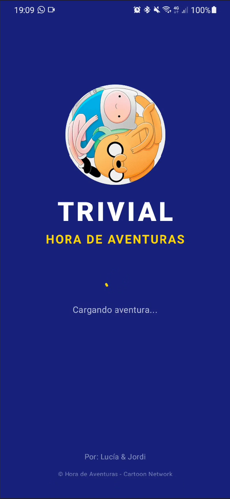
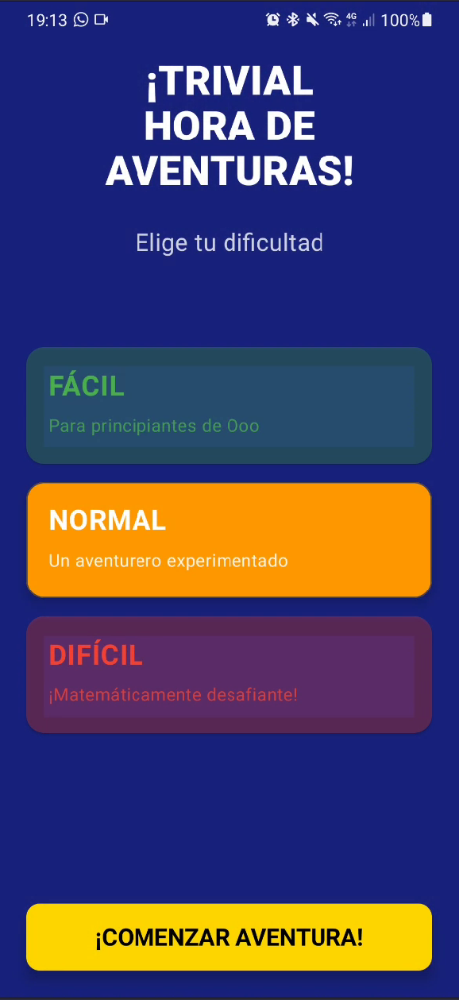
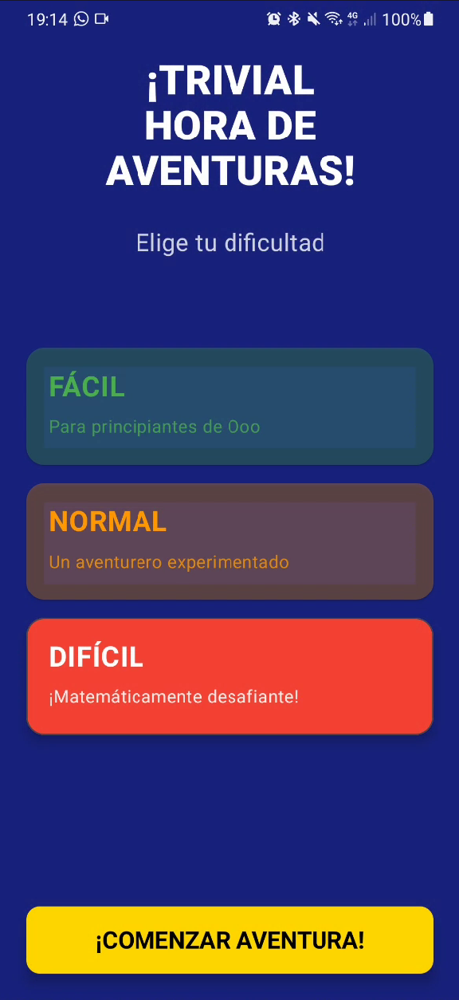
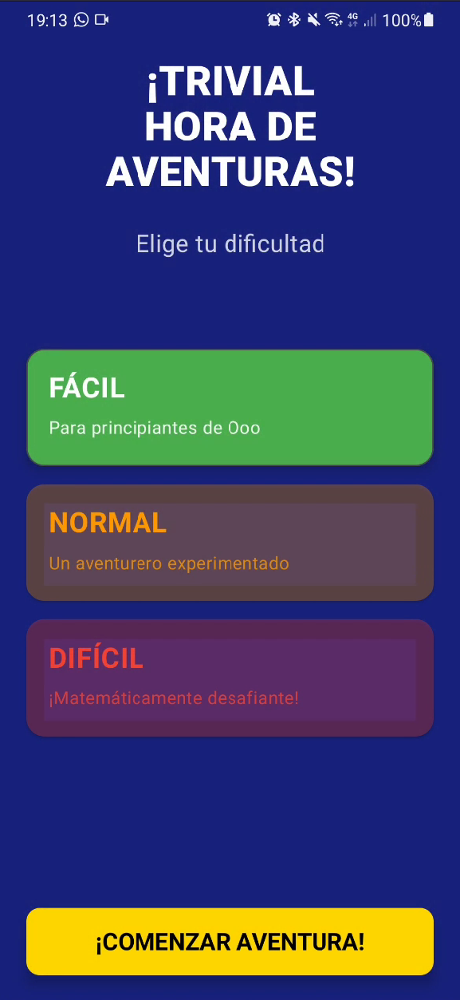
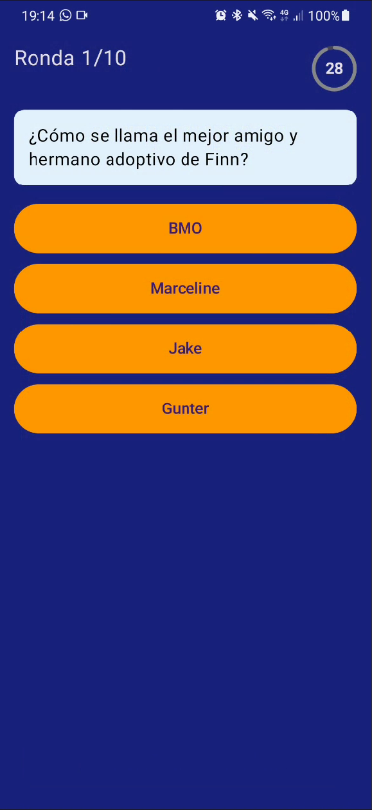
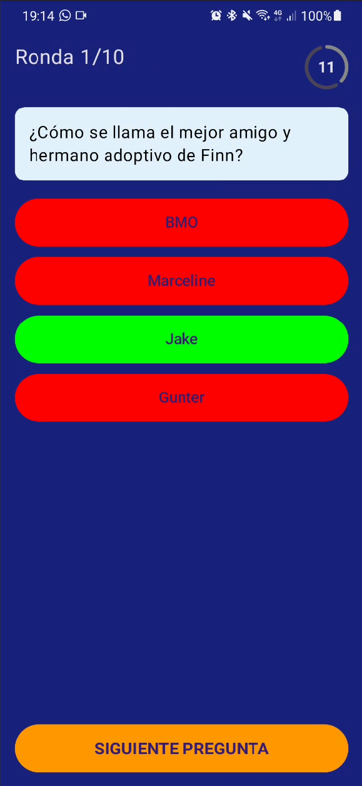
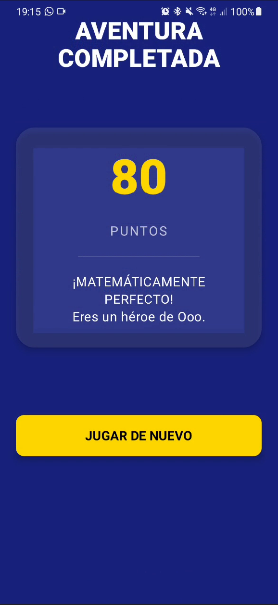

# 🗡️ **Trivial Hora de Aventuras** 🗡️

En el módulo de Desarollo de Interficies hemos desarollado un Trivial con temática de **Hora de Aventuras**, una seríe animada muy querida por muchos de nostortos. Es una aplicación de preguntas y respuestas desarrollada en Kotlin con Jetpack Compose y siguiendo la arquitectura MVVM.

## 🎻 Características Principales

### 🍭 **Pantallas Completas**
- **Splash Screen** - Presentación con logo (y icono de la app) personalizado
- **Menú Principal** - Selección de 3 dificultades con diferencaición de mensaje personalizado a la temática
- **Pantalla de Juego** - 10 rondas con temporizador y feedback visual de acierto o error utilizando colores autoexplicativos
- **Pantalla de Resultados** - Puntuación final con mensajes personalizados

### 🍭 **Funcionalidades de Juego**
- **3 Niveles de Dificultad**: Se diferencian las dificultades por conocimenientos más profundos del lore de la serie
- **Temporizador Circular**: 30 segundos por pregunta, cambia a rojo en últimos 10s
- **Sistema de Puntuación**: +10 puntos por respuesta correcta
- **Feedback Visual**: Respuestas correctas (verde) e incorrectas (rojo)
- **10 Rondas**: Flujo completo de juego

### 🍭 **Tecnología y Arquitectura**
- **Arquitectura MVVM** con separación clara de responsabilidades
- **LiveData** para manejo observable del estado
- **Jetpack Compose** para UI declarativa moderna
- **Navigation Component** para navegación entre pantallas
- **Material Design 3** para componentes UI

## 🐻‍❄️ Capturas de Pantalla

| Splash Screen |
|---------------|
|  |

| Menú Principal |
|----------------|
|    |

| Juego |
|-------|
|   |

| Resultados |
|------------|
|  |

## 🩸 Estructura del Proyecto

```
app/src/main/java/com/example/trivial/
├── MainActivity.kt                    # Punto de entrada y configuración
├── model/Game                         # Modelos de datos
│   ├── Game.kt
│   ├── Pregunta.kt
│   ├── Menu.kt
│   ├── Launch.kt
│   └── Result.kt
├── view/                              # Vistas
│   ├── LaunchView.kt                  # Splash Screen (3 segundos)
│   ├── MenuView.kt                    # Selección de dificultad
│   ├── GameView.kt                    # Pantalla principal del juego
│   └── ResultView.kt                  # Resultados
├── viewmodel/
│   └── TrivialViewModel.kt            # ViewModel principal con LiveData
├── ui/theme/
│   ├── Color.kt
│   ├── Theme.kt
│   └── Type.kt
└── nav/
    └── Routes.kt                      # Definición de rutas de navegación
```

## ❄️ Cómo Ejecutar el Proyecto

### 🐇 **Pasos**
1. Clonar el repositorio
2. Abrir en Android Studio
3. Sincronizar dependencias Gradle
4. Ejecutar en emulador o dispositivo físico

## 🐈 Cómo Jugar

1. **Inicio**: La app muestra el splash screen y navega automáticamente al menú
2. **Selección de Dificultad**: Elige entre Fácil, Normal o Difícil
3. **Juego**: Responde 10 preguntas antes de que se acabe el tiempo (30s cada una)
4. **Resultados**: Revisa tu puntuación y juega de nuevo

## 👥 Autores

**Lucía Martínez** - Desarrollo de UI/UX y pantallas <br>
**Jordi Ros López** - Lógica de negocio y ViewModel <br>
Módulo 0488: Desenvolupament d’interfícies

## 📄 Licencia

Este proyecto fue desarrollado con fines educativos. Basado en la serie "Hora de Aventuras" de Cartoon Network.
